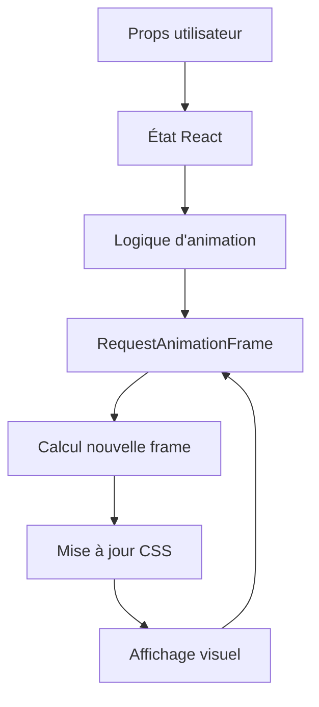

# Théorie et Fonctionnement de lavicon-animation

## Introduction

Ce document explique le fonctionnement théorique et pratique du projet `lavicon-animation`. Il s'agit d'une bibliothèque React qui permet d'animer des **spritesheets** (feuilles de sprites) pour créer des animations d'icônes fluides et interactives.

## 1. Concepts Fondamentaux

### 1.1 Qu'est-ce qu'une Spritesheet ?

Une **spritesheet** est une image unique qui contient plusieurs frames (images) d'une animation organisées en grille. Au lieu d'avoir 100 images séparées, on a une seule image contenant toutes les frames.

```
┌─────────────────────────────────────────────────┐
│ Frame 1 │ Frame 2 │ Frame 3 │ Frame 4 │ Frame 5 │
├─────────┼─────────┼─────────┼─────────┼─────────┤
│ Frame 6 │ Frame 7 │ Frame 8 │ Frame 9 │ Frame10 │
├─────────┼─────────┼─────────┼─────────┼─────────┤
│ Frame11 │ Frame12 │ Frame13 │ Frame14 │ Frame15 │
└─────────────────────────────────────────────────┘
```

**Avantages** :
- Une seule requête HTTP au lieu de dizaines
- Chargement plus rapide
- Pas de scintillement entre les frames
- Cache du navigateur plus efficace

### 1.2 Comment Fonctionne l'Animation ?

L'animation consiste à **afficher successivement** les différentes frames de la spritesheet à une vitesse donnée (FPS - Frames Per Second).

```
Temps: 0ms    33ms    66ms    100ms   133ms
Frame: 1  →   2   →   3   →   4   →   5
```

## 2. Architecture Générale

### 2.1 Structure du Projet

```
lavicon-animation/
├── src/
│   ├── components/
│   │   └── LaviconAnimation.tsx    # 🎯 Composant principal
│   └── index.ts                    # 📦 Point d'entrée
├── dist/                           # 🏗️ Build output
└── package.json                    # ⚙️ Configuration
```

### 2.2 Flux de Données



## 3. Architecture du Composant LaviconAnimation

### 3.1 Interface et Props

Le composant accepte plusieurs propriétés pour configurer l'animation :

```typescript
interface LaviconAnimationProps {
  // Configuration de la spritesheet
  url: string;              // URL de l'image spritesheet
  frameSize: number;        // Taille d'une frame dans la spritesheet
  cols: number;             // Nombre de colonnes dans la grille
  totalFrames: number;      // Nombre total de frames
  
  // Configuration d'affichage
  size: number;             // Taille d'affichage finale
  
  // Configuration d'animation
  fps: number;              // Vitesse d'animation (frames par seconde)
  triggerMode: TriggerMode; // Mode de déclenchement
  loop: boolean;            // Boucle l'animation
  initialFrame: number;     // Frame de départ
  
  // Configuration comportementale
  autoPlay: boolean;        // Lecture automatique
  onClick: () => void;      // Callback personnalisé
}
```

### 3.2 État du Composant

Le composant maintient plusieurs états :

```typescript
// États visuels
const [isHovering, setIsHovering] = useState(false);    // Survol souris
const [isPressed, setIsPressed] = useState(false);      // Appui bouton
const [isPlaying, setIsPlaying] = useState(autoPlay);   // Animation en cours

// État d'animation
const [currentFrame, setCurrentFrame] = useState(initialFrame); // Frame actuelle

// Références pour l'animation
const animationRef = useRef<number | null>(null);       // ID RequestAnimationFrame
const direction = useRef<'forward' | 'backward'>('forward'); // Direction
const animationLocked = useRef<boolean>(false);         // Verrou anti-spam
```

## 4. Modes de Déclenchement

### 4.1 Mode "hover" (Survol)

```
État initial: Frame 0
│
├─ Survol souris
│  └─ Animation forward: 0 → 1 → 2 → ... → fin
│
└─ Sortie survol
   └─ Animation backward: fin → ... → 2 → 1 → 0
```

**Cas d'usage** : Boutons, icônes interactives

### 4.2 Mode "click" (Clic)

```
État initial: Frame 0
│
├─ Clic utilisateur
│  ├─ Animation forward: 0 → 1 → 2 → ... → fin
│  └─ Animation backward: fin → ... → 2 → 1 → 0
│
└─ Retour à l'état initial
```

**Cas d'usage** : Boutons d'action, confirmations visuelles

### 4.3 Mode "auto" (Automatique)

```
État initial: Frame 0
│
├─ Lecture automatique
│  └─ Animation forward: 0 → 1 → 2 → ... → fin
│
├─ Si loop = true
│  └─ Retour à 0 et recommence
│
└─ Si loop = false
   └─ Arrêt à la dernière frame
```

**Cas d'usage** : Icônes de chargement, animations décoratives

## 5. Algorithmes Clés

### 5.1 Calcul de Position dans la Spritesheet

```typescript
function calculatePosition(frame: number, cols: number) {
  const col = frame % cols;           // Colonne = reste de la division
  const row = Math.floor(frame / cols); // Ligne = division entière
  
  return { col, row };
}
```

**Exemple** : Frame 13 dans une grille de 5 colonnes
- Colonne = 13 % 5 = 3
- Ligne = Math.floor(13 / 5) = 2

```
┌─────┬─────┬─────┬─────┬─────┐
│  0  │  1  │  2  │  3  │  4  │ ← Ligne 0
├─────┼─────┼─────┼─────┼─────┤
│  5  │  6  │  7  │  8  │  9  │ ← Ligne 1
├─────┼─────┼─────┼─────┼─────┤
│ 10  │ 11  │ 12  │ 13✓ │ 14  │ ← Ligne 2
└─────┴─────┴─────┴─────┴─────┘
```

### 5.2 Positionnement CSS

```typescript
const backgroundPosition = `-${col * frameSize}px -${row * frameSize}px`;
```

Cette technique utilise `background-position` pour décaler l'image et n'afficher que la frame souhaitée.

### 5.3 Gestion du Temps et des FPS

```typescript
const frameInterval = 1000 / fps; // Intervalle en millisecondes

function animateSprite(timestamp: number) {
  const elapsed = timestamp - lastFrameTime;
  
  if (elapsed >= frameInterval) {
    // Calculer combien de frames avancer
    const framesAdvance = Math.floor(elapsed / frameInterval);
    
    // Avancer la frame
    setCurrentFrame(prev => prev + framesAdvance);
    
    // Mettre à jour le temps de référence
    lastFrameTime = timestamp;
  }
  
  // Continuer l'animation
  requestAnimationFrame(animateSprite);
}
```

## 6. Optimisations Techniques

### 6.1 RequestAnimationFrame

Au lieu d'utiliser `setTimeout` ou `setInterval`, le projet utilise `requestAnimationFrame` :

**Avantages** :
- Synchronisation avec le taux de rafraîchissement de l'écran
- Pause automatique quand l'onglet n'est pas visible
- Meilleure performance et fluidité

```typescript
// ❌ Mauvaise pratique
setInterval(() => {
  nextFrame();
}, 1000 / fps);

// ✅ Bonne pratique
function animate(timestamp) {
  // Logique d'animation
  requestAnimationFrame(animate);
}
requestAnimationFrame(animate);
```

### 6.2 Limitation des FPS

```typescript
const frameInterval = 1000 / Math.min(fps, 120); // Maximum 120 FPS
```

**Pourquoi limiter ?**
- Éviter la surcharge CPU
- Économiser la batterie
- Assurer la cohérence entre différents appareils

### 6.3 Prévention du Saut de Frames

```typescript
// Limite l'avance à 3 frames maximum par cycle
const framesAdvance = Math.min(Math.floor(elapsed / frameInterval), 3);
```

**Problème résolu** : Si le navigateur est bloqué 200ms, on ne veut pas sauter 10 frames d'un coup.

## 7. Intégration Framer Motion

### 7.1 Micro-interactions

```typescript
// Valeurs animées
const scale = useMotionValue(1);
const y = useMotionValue(0);

// Springs pour la fluidité
const scaleSpring = useSpring(scale, { stiffness: 700, damping: 30 });
const ySpring = useSpring(y, { stiffness: 500, damping: 25 });

// Effet de pression
useEffect(() => {
  if (isPressed) {
    scale.set(0.95);  // Réduction de 5%
    y.set(2);         // Décalage de 2px vers le bas
  } else {
    scale.set(1);
    y.set(0);
  }
}, [isPressed]);
```

### 7.2 Animations de Survol

```typescript
<motion.div
  whileHover={{ 
    opacity: 1,
    scale: triggerMode === 'click' ? 1.02 : 1.05,
    transition: { duration: 0.2 } 
  }}
>
```

## 8. Système de Rendu

### 8.1 Technique du Conteneur avec Overflow

```typescript
// Conteneur principal - taille d'affichage
<div style={{ 
  width: `${size}px`, 
  height: `${size}px`,
  overflow: 'hidden' 
}}>
  
  // Image spritesheet - taille originale
  <div style={{
    width: `${frameSize}px`,
    height: `${frameSize}px`,
    backgroundImage: `url(${url})`,
    backgroundPosition: `${backgroundPosition}`,
    transform: `scale(${size / frameSize})` // Redimensionnement
  }} />
</div>
```

### 8.2 Calcul du Ratio

```typescript
const sizeRatio = size / frameSize;
```

**Exemple** :
- Frame originale : 196px × 196px
- Taille d'affichage : 64px × 64px
- Ratio : 64/196 = 0.326

## 9. Gestion des États d'Animation

### 9.1 Machine à États Simplifiée

```
┌─────────────┐
│   IDLE      │ ← État initial
│ (frame 0)   │
└─────────────┘
       │
       ├─ hover/click/auto
       ▼
┌─────────────┐
│  PLAYING    │ ← Animation en cours
│ (forward)   │
└─────────────┘
       │
       ├─ Mode hover: sortie survol
       ├─ Mode click: fin animation
       ▼
┌─────────────┐
│  REVERSING  │ ← Animation retour
│ (backward)  │
└─────────────┘
       │
       ├─ Retour à frame initiale
       ▼
┌─────────────┐
│   IDLE      │
│ (frame 0)   │
└─────────────┘
```

### 9.2 Gestion des Directions

```typescript
// Logique de changement de direction
if (direction.current === 'forward') {
  newFrame = Math.min(prevFrame + framesAdvance, totalFrames - 1);
  
  // Fin d'animation forward
  if (newFrame >= totalFrames - 1) {
    if (triggerMode === 'click' && !loop) {
      direction.current = 'backward'; // Retour automatique
    } else if (loop) {
      newFrame = initialFrame; // Recommencer
    }
  }
} else {
  // Animation backward
  newFrame = Math.max(prevFrame - framesAdvance, initialFrame);
  
  // Retour à la frame initiale
  if (newFrame <= initialFrame) {
    setIsPlaying(false);
    animationLocked.current = false;
  }
}
```

## 10. Système de Verrouillage

### 10.1 Prévention du Spam de Clics

```typescript
const handleClick = () => {
  if (triggerMode === 'click' && !animationLocked.current) {
    animationLocked.current = true; // Verrouiller
    setIsPlaying(true);
    
    // Le verrou sera libéré à la fin de l'animation
  }
};
```

**Pourquoi ?** Éviter qu'un utilisateur déclenche plusieurs animations simultanément.

### 10.2 Nettoyage des Ressources

```typescript
useEffect(() => {
  return () => {
    // Nettoyage automatique à la destruction du composant
    if (animationRef.current) {
      cancelAnimationFrame(animationRef.current);
    }
  };
}, []);
```

## 11. Performance et Optimisations

### 11.1 Optimisation CSS

```typescript
// Utilisation de transform au lieu de left/top
transform: `scale(${sizeRatio})`;

// Optimisation du rendu
imageRendering: 'crisp-edges'; // Pixels nets pour les icônes
```

### 11.2 Gestion Mémoire

- **Annulation automatique** des `requestAnimationFrame`
- **Nettoyage des références** à la destruction du composant
- **Limitation des calculs** avec le système de FPS

## 12. Accessibilité

### 12.1 Attributs ARIA

```typescript
<motion.div
  role="img"           // Définit comme une image
  aria-label={alt}     // Description textuelle
>
```

### 12.2 Support Clavier

Le composant hérite naturellement du support clavier de React pour les événements `onClick`.

## 13. Cas d'Usage Pratiques

### 13.1 Bouton d'Action

```typescript
<LaviconAnimation
  url="/icons/button-action.png"
  triggerMode="click"
  size={48}
  cols={8}
  totalFrames={24}
  fps={24}
/>
```

### 13.2 Icône de Chargement

```typescript
<LaviconAnimation
  url="/icons/loading.png"
  triggerMode="auto"
  autoPlay={true}
  loop={true}
  size={32}
  cols={6}
  totalFrames={18}
  fps={12}
/>
```

### 13.3 Effet de Survol

```typescript
<LaviconAnimation
  url="/icons/hover-effect.png"
  triggerMode="hover"
  size={64}
  cols={10}
  totalFrames={30}
  fps={30}
/>
```

## 14. Flux de Données Complet

```
1. Utilisateur déclenche l'animation (hover/click/auto)
   ↓
2. Changement d'état React (isHovering/isPlaying)
   ↓
3. useEffect détecte le changement
   ↓
4. Démarrage de requestAnimationFrame
   ↓
5. Fonction animateSprite appelée à chaque frame
   ↓
6. Calcul du temps écoulé
   ↓
7. Vérification si assez de temps pour changer de frame
   ↓
8. Mise à jour de currentFrame
   ↓
9. Recalcul de la position CSS
   ↓
10. Affichage de la nouvelle frame
    ↓
11. Retour à l'étape 5 (boucle)
    ↓
12. Arrêt quand conditions de fin remplies
```

## Conclusion

Le projet `lavicon-animation` est un exemple parfait d'architecture React moderne combinant :

- **Gestion d'état** avec hooks
- **Optimisations performance** avec RequestAnimationFrame
- **Animations fluides** avec calculs temporels précis
- **Flexibilité** avec multiples modes de déclenchement
- **Accessibilité** avec support ARIA

L'approche technique est solide et les optimisations permettent des animations fluides même avec des spritesheets complexes. Le code est maintenable et extensible grâce à sa structure modulaire et ses abstractions bien pensées.